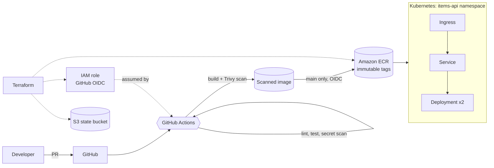

# items-api: platform onboarding

A small Go REST API, onboarded to a Kubernetes platform the way a production
service would be: hardened container, gated CI pipeline, locked-down manifests,
and the supporting AWS infrastructure in Terraform.

The goal is clean structure and sound defaults, not a finished production
system. Every shortcut is listed under [Shortcuts](#shortcuts-and-what-id-do-next).

## Contents

- [Architecture](#architecture)
- [Repository layout](#repository-layout)
- [Quick start (local)](#quick-start-local)
- [CI pipeline](#ci-pipeline)
- [Deploying to Kubernetes](#deploying-to-kubernetes)
- [Terraform](#terraform)
- [Secrets management](#secrets-management)
- [Migration: importing existing resources](#migration-importing-an-existing-resource-into-terraform)
- [Design decisions and trade-offs](#design-decisions-and-trade-offs)
- [Shortcuts and what I'd do next](#shortcuts-and-what-id-do-next)

## Architecture



## Repository layout

```
app/                    Go service (stdlib only) and tests
docker/                 Dockerfile and Dockerfile.dockerignore
.github/workflows/      ci.yml (app pipeline), terraform.yml (IaC checks)
k8s/
  base/                 Namespace, Deployment, Service, Ingress, NetworkPolicy,
                        ConfigMap, Secret, ServiceAccount, PDB
  overlays/dev/         Registry image + dev hostname
  overlays/local/       kind cluster: local image, 1 replica, no TLS
terraform/
  modules/ecr/                ECR repo + lifecycle policy (with tests)
  modules/github-oidc-role/   Least-privilege CI role via GitHub OIDC
  modules/state-bucket/       Hardened S3 bucket for remote state
  bootstrap/                  Creates the state bucket (local state first)
  envs/dev/                   Composes the modules; S3 remote backend
hack/kind-config.yaml   Local cluster with Calico for NetworkPolicy
Makefile                Same checks CI runs, for local use
```

### The API

| Endpoint | Purpose |
|---|---|
| `GET /api/v1/items`, `GET /api/v1/items/{id}` | Sample resource |
| `GET /healthz` | Liveness: process is up. Checks no dependencies on purpose |
| `GET /readyz` | Readiness: returns 503 while draining on shutdown |
| `GET /metrics` | Prometheus text format |
| `GET /version` | Build version (git SHA, injected at build time) |

On `SIGTERM` the service fails readiness, waits `SHUTDOWN_DRAIN_SECONDS` for
endpoints to update, then drains in-flight requests. Combined with
`maxUnavailable: 0`, rollouts drop no traffic.

## Quick start (local)

Prerequisites: Go 1.24+, Docker, and optionally `kind`, `kubectl`, `kustomize`,
`kubeconform`, `hadolint`, `trivy`, `terraform` >= 1.10.

```bash
make test        # unit tests with the race detector
make run         # API on http://localhost:8080
make build       # docker build -f docker/Dockerfile -t items-api:local .
make scan        # Trivy scan of the local image
make help        # all targets
```

## CI pipeline

### How to trigger it

| Event | What runs |
|---|---|
| Open or update a PR into `main` | Lint, test, secret scan, build, Trivy scan. **Nothing is pushed.** |
| Merge (push) to `main` | All of the above, then push the scanned image to ECR |
| Manual | Actions tab, select **CI**, then **Run workflow** |

```bash
git checkout -b feature/my-change
git commit -am "feat: my change"
git push -u origin feature/my-change
gh pr create --fill          # CI runs on the PR
gh pr merge --squash         # CI runs again on main and pushes
```

### Jobs

```
lint ─────────┐
test ─────────┼──> build-scan ──> push (main only)
secrets-scan ─┘
```

1. **lint**: golangci-lint, hadolint, dockerignore sync check, and
   `kustomize build | kubeconform` for every overlay.
2. **test**: `go test -race` with coverage in the job summary.
3. **secrets-scan**: gitleaks across full history.
4. **build-scan**: Buildx build (GHA layer cache), then Trivy. The SARIF report
   goes to the GitHub Security tab, and the job **fails on any fixable
   HIGH/CRITICAL** vulnerability.
5. **push**: loads the *exact image that was scanned* (passed as an artifact,
   not rebuilt), assumes the AWS role via OIDC, and pushes two tags:
   `<git-sha>` and `main-<run-number>`.

A second workflow, `terraform.yml`, runs `fmt`, `validate`, mocked
`terraform test`, TFLint and a Trivy misconfiguration scan over Terraform and
Kubernetes. It never needs AWS credentials.

### Connecting it to AWS

The push job is **skipped** until AWS is configured, so this public repo stays
green. To enable it:

1. Apply Terraform (below) and note the `ci_role_arn` output.
2. In GitHub, **Settings > Secrets and variables > Actions > Variables**, add:
   - `AWS_ROLE_ARN` = the `ci_role_arn` output
   - `AWS_REGION` = e.g. `eu-west-1`
   - `ECR_REPOSITORY` = `items-api`
3. Optionally add required reviewers to the `dev` environment to gate pushes.

There are **no AWS secrets** in GitHub. These are non-sensitive identifiers;
the role can only be assumed by this repo's `main` branch.

### Pipeline security choices

- `permissions: contents: read` at the top; jobs opt in to `security-events`
  or `id-token` only where needed.
- Every third-party action is **pinned to a commit SHA** (tag in a comment).
  Tags are mutable and have been hijacked in real supply-chain attacks.
  Dependabot keeps the pins current.
- PR runs can never push: the push job is conditioned on `main`, and the IAM
  trust policy independently only accepts `ref:refs/heads/main`.
- PR runs cancel when superseded; runs on `main` are never cancelled mid-push.

## Deploying to Kubernetes

### Local (kind)

```bash
make kind-up                      # kind + Calico (enforces NetworkPolicy) + ingress-nginx
make kind-deploy                  # build, load image, kubectl apply -k k8s/overlays/local
curl http://items-api.localtest.me/api/v1/items
make kind-down
```

### Any cluster

```bash
# Preview what will be applied
kustomize build k8s/overlays/dev

# Server-side dry run against the cluster's admission chain
kubectl apply -k k8s/overlays/dev --dry-run=server

# Apply and wait
kubectl apply -k k8s/overlays/dev
kubectl -n items-api rollout status deploy/items-api

# Verify
kubectl -n items-api get pods,svc,ingress,networkpolicy
kubectl -n items-api port-forward svc/items-api 8080:80 &
curl -s localhost:8080/readyz
```

Set the image for a release by updating the overlay (this is what a GitOps
flow would automate):

```bash
cd k8s/overlays/dev && kustomize edit set image items-api=<account>.dkr.ecr.<region>.amazonaws.com/items-api:<git-sha>
```

Cluster prerequisites: an NGINX ingress controller in the `ingress-nginx`
namespace, cert-manager with a `letsencrypt` ClusterIssuer (dev overlay), and
a CNI that **enforces** NetworkPolicy (Calico, Cilium, or the AWS VPC CNI with
network policy enabled). Without one, policies are accepted but silently ignored.

### What the manifests enforce

| Concern | How |
|---|---|
| Pod hardening | Namespace enforces Pod Security `restricted`. Non-root UID 65532, read-only root FS, all capabilities dropped, no privilege escalation, seccomp `RuntimeDefault` |
| API access | Dedicated ServiceAccount, token not mounted |
| Availability | 2 replicas, `maxUnavailable: 0`, PDB `minAvailable: 1`, spread across nodes |
| Health | `startupProbe` gates the others; liveness on `/healthz`, readiness on `/readyz` |
| Resources | Requests and limits on CPU and memory |
| Network | Default deny all, ingress only from ingress-nginx on 8080, egress only to kube-dns on 53 |

## Terraform

### Structure

Three small reusable modules, composed by thin root configurations:

- **`modules/ecr`**: immutable tags, scan on push, encryption (AES256 or a
  supplied CMK), and a lifecycle policy that expires untagged images after 7
  days and keeps the last 30 tagged images.
- **`modules/github-oidc-role`**: GitHub OIDC provider (or lookup of an
  existing one, since it is account-wide) and a role whose trust policy checks
  both `aud` and `sub`. Permissions are push/pull on the given repository ARNs
  only. `ecr:GetAuthorizationToken` is on `*` because AWS does not support
  resource scoping for it.
- **`modules/state-bucket`**: versioning, SSE-KMS with a rotating key, public
  access fully blocked, ACLs disabled, TLS-only bucket policy, noncurrent
  version expiry, and `prevent_destroy`.

Every variable has a type and description, inputs that can be wrong have
`validation` blocks, and outputs are documented with where they are used.

### Apply order

The state bucket has a chicken-and-egg problem: it cannot hold its own state
before it exists.

```bash
# 1. Bootstrap the state bucket with local state
cd terraform/bootstrap
cp terraform.tfvars.example terraform.tfvars    # set a globally unique bucket name
terraform init && terraform apply

# 2. Move bootstrap state into the bucket it just created
#    (uncomment the backend "s3" block in versions.tf first)
terraform init -migrate-state

# 3. Deploy ECR + CI role with the remote backend
cd ../envs/dev
cp backend.hcl.example backend.hcl              # bucket, region, KMS key from step 1 outputs
cp terraform.tfvars.example terraform.tfvars    # account ID, GitHub repo
terraform init -backend-config=backend.hcl
terraform plan -out=tfplan
terraform apply tfplan
```

The backend uses **S3-native locking** (`use_lockfile = true`, Terraform 1.10+),
so no DynamoDB table is needed. `allowed_account_ids` on the provider stops a
plan from ever running against the wrong account.

### Testing without AWS

```bash
make tf-check     # fmt, validate and `terraform test` everywhere
```

`terraform test` uses a **mocked AWS provider**: it checks that ECR tags are
immutable, scanning is on, the lifecycle policy exists, and that bad inputs
(account ID, repo format, environment) are rejected. No credentials, no cost.

## Secrets management

Nothing sensitive is committed. Three layers:

1. **CI to AWS**: GitHub OIDC. Short-lived credentials per run, no stored keys.
2. **App secrets in-cluster**: `k8s/base/secret.yaml` holds placeholders only.
   The intended production setup is **External Secrets Operator** reading from
   **AWS Secrets Manager**, authenticated with IRSA or EKS Pod Identity on the
   ServiceAccount (annotation stubbed in `serviceaccount.yaml`). The
   `ExternalSecret` would replace `secret.yaml` and produce a Secret of the same
   name, so the Deployment does not change.
3. **Prevention**: `.gitignore` excludes state, `*.tfvars` and `backend.hcl`;
   gitleaks runs in CI and as a pre-commit hook.

## Migration: importing an existing resource into Terraform

Goal: bring a manually created resource (say an ECR repository called
`legacy-api`) under Terraform without recreating it or causing downtime.

1. **Inventory and freeze.** Record the resource's current configuration
   (`aws ecr describe-repositories`, lifecycle policy, repo policy, tags).
   Announce a short change freeze on it so the console and code do not drift
   mid-migration.
2. **Declare the import in code** (Terraform 1.5+), so it is reviewed in a PR
   like any other change:

   ```hcl
   import {
     to = module.legacy_ecr.aws_ecr_repository.this
     id = "legacy-api"
   }
   ```

3. **Generate a starting point** if writing it by hand is tedious:
   `terraform plan -generate-config-out=generated.tf`, then fold the result into
   the module and delete the generated file.
4. **Iterate until the plan is a no-op.** The target is
   `Plan: 1 to import, 0 to add, 0 to change, 0 to destroy`. Pay most attention
   to attributes that **force replacement** (name, encryption type, KMS key):
   change the *code* to match reality, never the other way round. Small
   in-place diffs like tags are acceptable if intended.
5. **Protect it.** Add `lifecycle { prevent_destroy = true }` for stateful or
   critical resources. Confirm the state bucket is versioned so the pre-import
   state can be restored.
6. **Apply in a PR** with the plan output attached. Only the import is
   recorded; the resource itself is untouched.
7. **Follow-ups.** Remove the `import` block (or leave it, it is a no-op once
   done). Reorganise later with `moved {}` blocks rather than destroying and
   recreating. Run a scheduled `terraform plan` to catch future console drift.

For resources with sub-resources (e.g. the repo's lifecycle policy), import
each one separately. For many resources, script the `import` blocks from an
inventory rather than hand-writing them.

## Design decisions and trade-offs

| Decision | Why | Trade-off |
|---|---|---|
| Go, stdlib only | Static binary on distroless, no dependency CVEs, tiny image | Hand-rolled `/metrics` instead of the Prometheus client |
| `distroless/static:nonroot` | No shell or package manager, very small attack surface | Cannot `kubectl exec` a shell; use ephemeral debug containers |
| `.dockerignore` as an allowlist | Safer default: new files are excluded until needed | Two copies (BuildKit reads `docker/Dockerfile.dockerignore`, legacy builders read the root one). CI checks they match |
| Scan before push, push the same artifact | A vulnerable image never reaches ECR, and the pushed digest is the one scanned | Image tarball passed between jobs (a few MB) |
| Immutable SHA tags, no `latest` | Every deploy is traceable to a commit; rollbacks are reliable | Must update the overlay to deploy (by design, GitOps-friendly) |
| OIDC role, `main` only | No long-lived keys; PRs and forks cannot push | Role must be created before the first push |
| Kustomize over Helm | Plain YAML for a single service, easy to review | Less templating; Helm would suit a shared chart |
| CPU limit set | Brief requires limits | CPU limits can cause throttling; many teams set only requests |
| ingress-nginx | Ubiquitous and simple for the exercise | The community ingress-nginx project has been retired; Gateway API is the forward path |
| CI does not apply Terraform | Keeps the exercise safe and credential-free | Real setup would run plan on PR and apply on merge with approval |

## Shortcuts and what I'd do next

Shortcuts taken:

- **No CD.** CI stops at pushing the image. Deploys are `kubectl apply -k`.
- **Base images are pinned by tag, not digest.** Run
  `docker buildx imagetools inspect <image>` and add `@sha256:...` before real
  use; Dependabot will then maintain the digests.
- **No `.terraform.lock.hcl` committed.** Run `terraform init` once per root and
  commit the lock files so provider versions are pinned.
- **Single environment** (`dev`). Staging and prod would be extra
  `envs/` and `overlays/` directories reusing the same modules.
- **No access logging on the state bucket** (needs a separate log bucket).
  Recorded in `.trivyignore` with the reason, alongside the other accepted findings.
- **In-memory data.** The API has no database; the egress policy has a
  commented example for adding one.
- Placeholder hostnames, account IDs and GitHub org (`your-org`) throughout.

Next steps:

- **GitOps**: Argo CD watching `k8s/overlays/*`. CI opens a PR bumping the
  image tag; merge triggers sync. Rollback is a git revert.
- **Supply chain**: cosign keyless signing in CI, SBOM via syft, and a Kyverno
  policy that only admits signed images from our ECR.
- **Observability**: ServiceMonitor for Prometheus, OpenTelemetry tracing,
  SLO-based alerts on error rate and latency, structured logs already in place.
- **Scaling**: HPA on CPU (or request rate via KEDA).
- **Terraform in CI**: plan on PR with the output as a comment, apply on merge
  behind an environment approval, plus scheduled drift detection.
